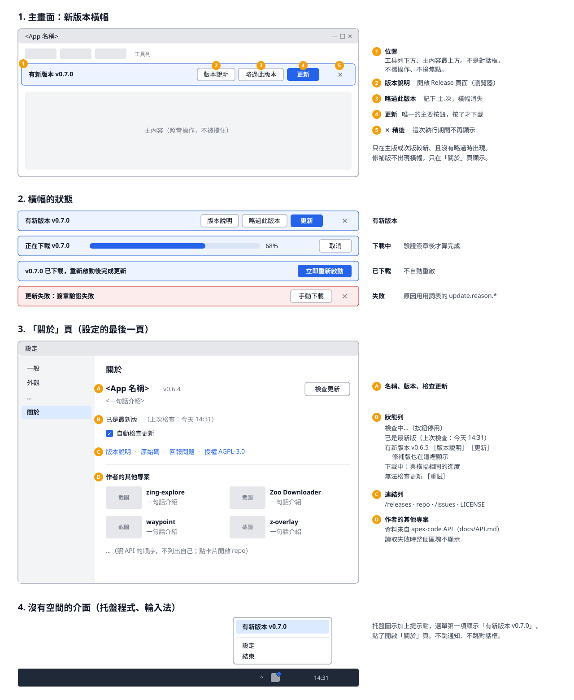

# UI 規範：更新與「關於」

各 app 用自己的介面框架（Win32／Direct2D、Slint、React、Svelte、網頁）實作。這份規範統一**結構、行為與用詞**，不規定顏色、字型與尺寸，照各 app 原本的風格。

**版面以這張圖為準**：區塊的位置、順序、按鈕順序與哪個是主要按鈕照圖實作；顏色、字型、尺寸照各 app 自己的風格。



## 1. 主畫面的新版本橫幅

只在 [UPDATE.md](UPDATE.md) 第 3 節「主版或次版較新、沒有略過」時出現。

```
┌ 視窗 ─────────────────────────────────────────────────────────┐
│ 工具列                                                        │
│ 主內容（版面不因橫幅移動）                                     │
│                                                               │
│        ┌──────────────────────────────────────────────────┐   │
│        │ 有新版本 v0.7.0   [版本說明] [略過此版本] [更新] ✕ │   │
│        └──────────────────────────────────────────────────┘   │
└───────────────────────────────────────────────────────────────┘
```

| 項目 | 規則 |
|---|---|
| 位置 | **浮在主內容右下角**（離邊緣約 16px，有陰影），疊在內容上方，**不佔版面、不推擠原本的介面**。不是對話框，不擋其他操作，不搶焦點 |
| 寬度 | 依內容，最寬不超過主內容寬度；視窗太窄時文字與按鈕可以換行 |
| 版本說明 | 開啟 Release 頁面（瀏覽器） |
| 略過此版本 | 記下 `主.次`，橫幅消失 |
| 更新 | 主要按鈕。開始下載，橫幅變成進度 |
| ✕ | 稍後：這次執行期間不再顯示 |
| 沒有空間的介面（托盤程式、輸入法） | 改在托盤圖示與它的選單顯示「有新版本 v0.7.0」，點了開啟「關於」頁 |

### 橫幅的狀態

```
有新版本 v0.7.0                       [版本說明] [略過此版本] [更新] ✕
正在下載 v0.7.0  ███████░░░  68%                              [取消]
v0.7.0 已下載，重新啟動後完成更新                        [立即重新啟動]
更新失敗：簽章驗證失敗                               [手動下載] ✕
```

## 2. 「關於」頁

放在設定的最後一頁。所有 app 同樣的順序：

```
關於
┌─────────────────────────────────────────────────────┐
│ <App 名稱>  v0.6.4                         [檢查更新] │
│ <一句話介紹>                                          │
│                                                     │
│ 已是最新版                                           │  ← 狀態列（見下表）
│ ☑ 自動檢查更新                                        │
│                                                     │
│ 版本說明 · 原始碼 · 回報問題 · 授權 AGPL-3.0           │
├─────────────────────────────────────────────────────┤
│ 作者的其他專案                                        │
│ [封面] zing-explore        [封面] Zoo Downloader     │
│        一句話介紹                 一句話介紹           │
└─────────────────────────────────────────────────────┘
```

| 狀態 | 顯示 |
|---|---|
| 檢查中 | 檢查中…（「檢查更新」按鈕停用） |
| 已是最新版 | 已是最新版（上次檢查：今天 14:31） |
| 有新版本（含修補版） | 有新版本 v0.6.5 ［版本說明］［更新］ |
| 下載中 | 與橫幅相同的進度 |
| 檢查失敗 | 無法檢查更新 ［重試］ |

- 「版本說明」連到 `https://github.com/zoosewu/<repo>/releases`，「回報問題」連到 `/issues`。
- 「作者的其他專案」依 apex-code 的 API 指引實作：<https://github.com/zoosewu/apex-code/blob/main/docs/API.md>。讀取失敗時整個區塊不顯示。
- Docker 專案的「關於」放在管理頁，「更新」改為顯示更新指令（見 UPDATE.md 第 7 節）。

## 3. 用詞

各 app 一字不差使用下表。介面有日文的 app 一併使用日文欄。

| 鍵 | 繁體中文 | English | 日本語 |
|---|---|---|---|
| `update.available` | 有新版本 {version} | Version {version} is available | 新しいバージョン {version} があります |
| `update.notes` | 版本說明 | Release notes | リリースノート |
| `update.skip` | 略過此版本 | Skip this version | このバージョンをスキップ |
| `update.install` | 更新 | Update | 更新 |
| `update.later` | 稍後 | Later | 後で |
| `update.downloading` | 正在下載 {version} | Downloading {version} | {version} をダウンロード中 |
| `update.cancel` | 取消 | Cancel | キャンセル |
| `update.restart` | 立即重新啟動 | Restart now | 今すぐ再起動 |
| `update.ready` | {version} 已下載，重新啟動後完成更新 | {version} is ready. Restart to finish updating | {version} の準備ができました。再起動すると更新が完了します |
| `update.failed` | 更新失敗：{reason} | Update failed: {reason} | 更新に失敗しました：{reason} |
| `update.manual` | 手動下載 | Download manually | 手動でダウンロード |
| `update.check` | 檢查更新 | Check for updates | 更新を確認 |
| `update.checking` | 檢查中… | Checking… | 確認中… |
| `update.latest` | 已是最新版 | You're up to date | 最新バージョンです |
| `update.lastChecked` | 上次檢查：{time} | Last checked: {time} | 最終確認：{time} |
| `update.checkFailed` | 無法檢查更新 | Couldn't check for updates | 更新を確認できませんでした |
| `update.retry` | 重試 | Retry | 再試行 |
| `update.auto` | 自動檢查更新 | Check for updates automatically | 自動的に更新を確認 |
| `update.reason.signature` | 簽章驗證失敗 | the signature didn't match | 署名を確認できませんでした |
| `update.reason.network` | 無法連線 | couldn't connect | 接続できませんでした |
| `about.title` | 關於 | About | このアプリについて |
| `about.source` | 原始碼 | Source code | ソースコード |
| `about.issues` | 回報問題 | Report a problem | 問題を報告 |
| `about.license` | 授權 {license} | License: {license} | ライセンス：{license} |
| `about.otherProjects` | 作者的其他專案 | More by the author | 作者のほかのプロジェクト |
| `update.docker.command` | 在伺服器上執行以下指令更新 | Run this on the server to update | サーバーで次のコマンドを実行して更新します |

鍵名供參考，各 app 照自己的翻譯檔格式命名。

## 4. 行為細節

- 鍵盤可以操作橫幅與「關於」頁所有按鈕。
- 自動檢查期間不顯示任何東西；只有結果是「有新版本」時才出現橫幅。
- 時間用相對日期（今天、昨天）＋ 24 小時制。
- 不使用彈出式對話框詢問是否更新。
